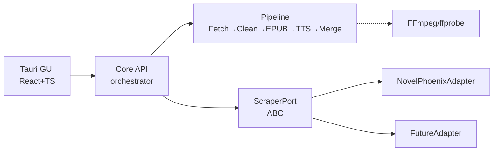
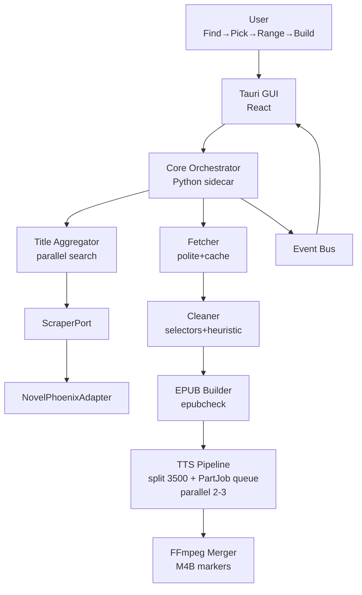

---
name: Speak EPUB
type: architecture-spine
purpose: build-substrate
altitude: feature
paradigm: Modular Pipes-and-Filters + Ports & Adapters
scope: NovelPhoenix scraper → clean EPUB → Edge TTS → Tauri desktop GUI (brownfield extension of Speak-EPUB-1.0.0/speak.py)
status: final
created: 2026-08-27
updated: 2026-08-27
binds: [scrape, clean, epub-build, tts-chunk, queue, m4b, gui-shell]
sources:
  - _bmad-output/planning-artifacts/briefs/brief-speak-epub-2026-08-27/brief.md
  - _bmad-output/planning-artifacts/briefs/brief-speak-epub-2026-08-27/addendum.md
  - _bmad-output/planning-artifacts/ux-designs/ux-speak-epub-2026-08-27/DESIGN.md
  - _bmad-output/planning-artifacts/ux-designs/ux-speak-epub-2026-08-27/EXPERIENCE.md
  - Speak-EPUB-1.0.0/speak.py
companions: []
---

# Architecture Spine — Speak EPUB

## Design Paradigm

**Modular Pipes-and-Filters + Ports & Adapters (hexagonal at scrape boundary).**

- **Pipes-and-Filters** for the load-bearing pipeline: `Fetch (adapter) → Clean (selectors+filters) → EPUB Build → TTS Chunk (split_text_for_tts) → PartJob Queue → FFmpeg Merge → M4B`. Each filter is stateless on its input, testable, and re-entrant for resume.
- **Ports & Adapters** at the edge: `Core` exposes a `ScraperPort` (`search(title)`, `listChapters(url)`, `fetchChapter(url)`, `getSelectors()`); `NovelPhoenixAdapter` is first, others plug in without touching core. Title aggregator is a port consumer, not a new core.
- Tauri GUI is a **thin shell** over Core via sidecar IPC — never owns pipeline state, only renders events and persists config.

## Invariants & Rules

### AD-1 — Dependency direction [ADOPTED]

- **Binds:** all
- **Prevents:** circular imports where adapters import GUI/TTS or pipeline imports concrete adapters, causing two incompatible site implementations
- **Rule:** `GUI (Tauri+React) → Core API → Pipeline stages` and `Core → Port → Adapter`. Adapter → nothing. Pipeline stages never import adapters directly. Enforcement: `core/ports.py` defines `ScraperPort` ABC; `adapters/novelphoenix.py` implements it. Import linter bans `adapters → core.pipeline` and `core → adapters.*` direct.



### AD-2 — Filtering stage

- **Binds:** clean, epub-build, tts-chunk
- **Prevents:** two truths where EPUB has nav noise but M4B is clean (or vice versa) because filters applied twice/differently
- **Rule:** User-defined filter phrases (plain `contains` + regex) are applied **once, at EPUB build**, on cleaned text after selector isolation. Raw cache and fetched HTML stay unfiltered. TTS automatically inherits cleanliness because it reads the built EPUB via `extract_chapters`. No filtering in Fetcher or TTS chunker.

### AD-3 — Politeness ownership

- **Binds:** scrape
- **Prevents:** ban after 4–5 rapid fetches (observed) from aggressive or GUI-driven tuning
- **Rule:** Fetcher owns `delay` (`3-5s + jitter` default, `10s safe` [ADOPTED]) and adaptive backoff: on HTTP 429, increment delay to next tier, jitter, retry with exponential wait (cap 20s), emit `throttleChanged`. Core orchestrator decides tier switch, not GUI. GUI only displays tier. All fetches are sequential (no parallel scrape) even if TTS later runs parallel.

### AD-4 — Sidecar contract [ADOPTED with spike]

- **Binds:** gui-shell, core
- **Prevents:** GUI bypassing Core invariants via direct FS writes or re-implementing EPUB/TTS, and OS-specific venv path drift
- **Rule:** Tauri Rust backend spawns Python sidecar via `tauri-plugin-shell` and talks JSON-RPC over stdin/stdout (primary). Path resolved by `core/config.py` OS detection: `Speak-EPUB-1.0.0/venv/Scripts/python.exe` (Win) vs `venv/bin/python` (macOS/Linux). GUI never writes EPUB/MP3 directly; all file paths resolved by Core. 10-min spike test (`shell` + venv spawn + emit) required; fallback to HTTP localhost if spike fails. Decision is load-bearing because it fixes IPC shape for both sides.

### AD-5 — State ownership

- **Binds:** all
- **Prevents:** split ownership of chapter index where GUI and Core disagree on `from–to`/missing vs new
- **Rule:** Core owns: chapter list, raw HTML cache (`_cache/<hash>/raw/`), cleaned text, EPUB manifest, PartJob queue, progress derivation. Adapters own: `start/end` CSS selectors + heuristic fallback (`article`/`div.chapter-content`). GUI is stateless view + persisted config mirror only. Resume badge (`skipped N, fetching X–Y`) computed by Core diffing cache vs desired range.

### AD-6 — Single event bus

- **Binds:** gui-shell, queue
- **Prevents:** two progress sources (polling + push) disagreeing on chapter/part status
- **Rule:** One bus: Core emits typed events via Tauri `emit` → React `listen`: `chapterStatus`, `partStatus`, `logLine`, `throttleChanged`, `done`. No polling. `partStatus` includes `PartJob` fields (`chapter_number`, `part_number`, `part_count`, `is_final_chapter_file`). GUI renders exactly what Core emits.

### AD-7 — Content boundary

- **Binds:** clean
- **Prevents:** silent inclusion of nav/footer/subscription chrome when site layout drifts
- **Rule:** Per-adapter `start`/`end` selectors are source of truth. Heuristic fallback never auto-overwrites them; preview pane allows manual override stored as per-adapter overlay (`adapters/overrides/<site>.json`). Original vs Cleaned tabs show diff. On layout drift, user correction re-parses live.

### AD-8 — EPUB as intermediate invariant [ADOPTED]

- **Binds:** epub-build, tts-chunk, m4b
- **Prevents:** divergent text between EPUB and audio because TTS fed raw HTML
- **Rule:** Build EPUB first, gate on `epubcheck` clean [ADOPTED from brief success criteria]. Then feed that EPUB into existing `extract_chapters` → `split_text_for_tts` → `PartJob` pipeline (same path as `speak.py --start-chapter`). No TTS from raw HTML path. Keeps truncation/marker logic unified.

### AD-9 — Resume semantics

- **Binds:** scrape, epub-build
- **Prevents:** duplicate fetches or missed new chapters on re-run, and split-brain cache keys
- **Rule:** Core owns canonical `cacheKey(url) = sha1(normalized_url)` in `core/fetch.py` — adapters never compute keys. Bounded range `20–100` → diff desired range vs cache and fetch only missing. Open-ended `to-end` (no `end-chapter`) → re-validate `listChapters` to detect new count, then fetch missing. Raw cache files are never filtered (test: raw contains filter phrase while EPUB text does not). Logs state whether `_parts/*.mp3` skipped.

### AD-10 — Config persistence [ASSUMPTION]

- **Binds:** gui-shell, core
- **Prevents:** CLI/GUI drift where `--voice` vs Settings picker diverge
- **Rule:** Single local JSON via `tauri-plugin-store` (`store.json`) mirrors all CLI equivalents: `voice`, `rate`, `parallel` (2–3), `chunk-size` (3500), `retries` (5), `scrapeDelay`, `safeMode`, `keepEPUB/MP3/M4B`, `filters[]`. GUI writes on blur, Core reads on start. No env vars/registry. CLI remains headless parity (`speak.py` flags) and reads same store as fallback [ASSUMPTION].

## Consistency Conventions

| Concern | Convention |
|---|---|
| Naming (entities, files, interfaces, events) | `ScraperPort` ABC in `core/ports.py`; adapters `adapters/<site>.py`; pipeline modules `core/fetch.py`, `core/clean.py`, `core/epub.py`, `core/tts.py` (ratifies `speak.py` names). Events `chapterStatus`/`partStatus` camelCase; files `<slug>_chapters_<from>_to_<to>.epub/.m4b` (ratifies existing). |
| Data & formats (ids, dates, error shapes, envelopes) | Chapter id = spine order 1..N; `PartJob` dataclass frozen (ratified). Cache key = `sha1(normalized_url)` owned by Core (AD-9). Raw cache at `_cache/<hash>/raw.html` never filtered; cleaned text filtered at EPUB gate. Error envelope `{code, message, retryable, delay}`; dates ISO 8601; HTML cache UTF-8. |
| State & cross-cutting (mutation, errors, logging, config, auth) | Only Core mutates pipeline state; adapters pure functions. Retries 5 with backoff `min(20, 2*attempt)` [ADOPTED]; FFmpeg/ffprobe checked via `shutil.which`; logs `role=log` to GUI bus. No auth in v1; cookie/header port hidden behind experimental flag [ADOPTED from addendum]. |

## Stack

| Name | Version | Note |
|---|---|---|
| Python | 3.10+ | runtime (3.14 in current venv, but floor 3.10) |
| ebooklib | 0.20 | EPUB build/read |
| BeautifulSoup4 | 4.14.3 | HTML parse |
| lxml | 6.0.2 | parser |
| edge-tts | 7.2.8 | TTS (verified 2026-03-22 PyPI) |
| FFmpeg / ffprobe | system PATH | merge + markers; `ffmpeg -version` check |
| Tauri | 2.11.5 | verified 2026-07-01 (core), @tauri-apps/api 2.11.1, cli 2.11.4 |
| create-tauri-app | 4.7.3 | starter [ASSUMPTION] |
| Frontend | React 18 + TypeScript 5 + Vite 6 + Tailwind 4 + shadcn/ui | recommended [ASSUMPTION] — matches UX DESIGN.md tokens |
| Persist | tauri-plugin-store 2.x | config JSON [ASSUMPTION] |
| Shell | tauri-plugin-shell | sidecar spawn [ASSUMPTION] |

## Structural Seed

### System view



### Source tree (seed)

```text
Speak-EPUB-1.0.0/
  core/                 # Python sidecar package (new)
    ports.py            # ScraperPort ABC + DTOs
    aggregator.py       # title-search across adapters
    fetch.py            # polite fetch + cache + adaptive 429
    clean.py            # selector isolation + heuristic fallback
    epub.py             # EPUB assembly + epubcheck gate + filter apply
    tts.py              # split_text_for_tts + PartJob queue (ratified)
    merge.py            # FFmpeg concat + M4B markers
    config.py           # store.json mirror + CLI flag compat
  adapters/
    novelphoenix.py     # list/fetch/search + selectors + cover
    base.py             # helper: fallback guessing
    overrides/          # user-corrected selectors per site
  venv/Scripts/python.exe  # [ADOPTED] per AGENTS.md, never bare python
  speak.py              # [ADOPTED] brownfield, delegates to core/tts after EPUB gate
src-tauri/
  src/                  # React TS (Find, ChapterList+Preview, Queue, Settings, Filters)
  Cargo.toml            # tauri 2.11.5, plugins store+shell
```

### Deployment & environments

Single desktop artifact per OS (Tauri bundler): `Win` via `Run-SpeakEPUB-Tauri.cmd` [ADOPTED], `macOS`/`Linux` via Tauri bundle. No server component; all processing local. FFmpeg bundled or PATH-checked. Local-only, zero data leaves device after fetch [ADOPTED].

## Capability → Architecture Map

| Capability / Area | Lives in | Governed by |
|---|---|---|
| Find — URL/title → search aggregator + fallback guessing | `core/aggregator.py` + `core/ports.py` | AD-1, AD-5, paradigm Ports & Adapters |
| Choose — chapter list + from–to + checkboxes | `core/fetch.py` (list) + `GUI ChapterList` | AD-5, AD-9 |
| Fetch & clean — polite fetch, cache, selector isolation, preview, filters plain+regex | `core/fetch.py`, `core/clean.py`, `adapters/*` | AD-2, AD-3, AD-5, AD-7 |
| Build EPUB — cover/TOC/metadata, validated | `core/epub.py` | AD-2, AD-8, Stack epubcheck |
| Make audio — chunk 3500, PartJob parallel 2–3, FFmpeg M4B markers, resume | `core/tts.py`, `core/merge.py` ratified from `speak.py` | AD-8 (brownfield), AD-6, Stack edge-tts |
| Control — progress per chapter/part, logs, keep switches, Settings persistence, Filters window, resume conditional | `GUI` + `core/config.py` + event bus | AD-4, AD-6, AD-10 |

## Deferred

| Decision | Why it can wait |
|---|---|
| Exact sidecar IPC transport (JSON-RPC stdin/stdout vs HTTP localhost vs file-watch) | Core/GUI contract is JSON events + file paths; transport is replaceable behind Core API — pick at impl when bundling `venv` binary vs `python -m` |
| Cache key shape (`URL` only vs `URL+hash` vs `ETag`) + eviction | Resume semantics AD-9 fixes behavior; key is internal to `fetch.py` |
| Batch queue of multiple novels | Out of scope per brief; no invariant needed for single-novel v1 |
| Logged-session paywall bypass (cookie/header) | Port designed for it, hidden behind experimental flag per addendum — expose only when site needs auth |
| Non-Edge TTS engines | Edge-tts is pinned; abstraction deferred until second engine demanded |
| M4B chapter marker encoding detail (FFmpeg chapter metadata) | Deferred to `merge.py` impl, verify with `ffprobe duration ms` on Win |
| Cloud sync, auto-update, mobile, >5-site bulk, collaborative filters | Explicit out v1 per brief |
| i18n language (EN vs PL default) | UX tagged [ASSUMPTION] EN; locale is GUI string table, not architecture |


